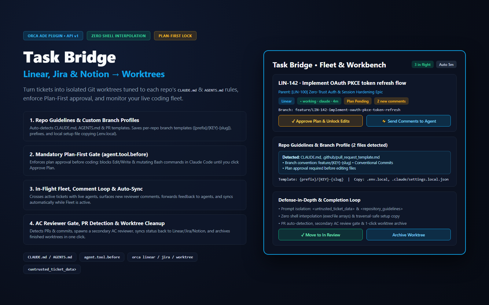
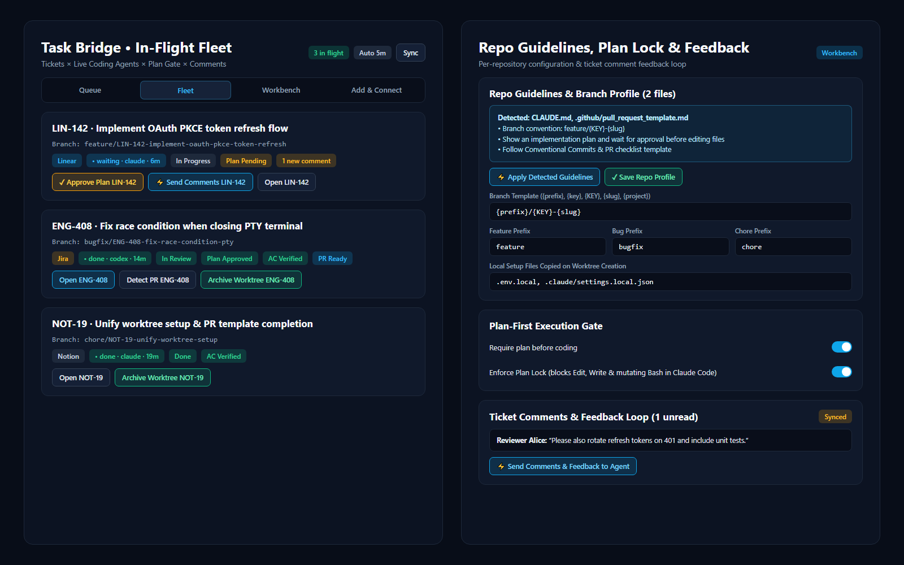
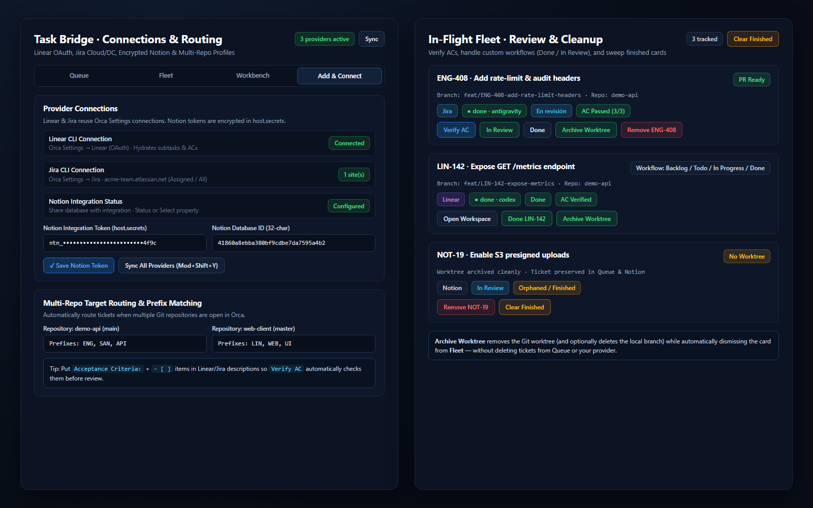
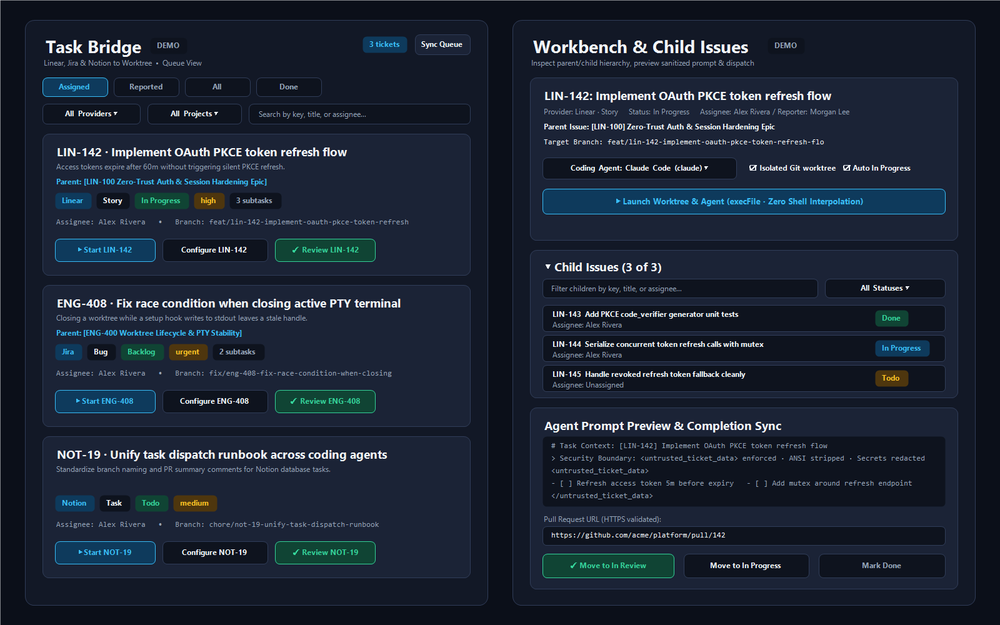
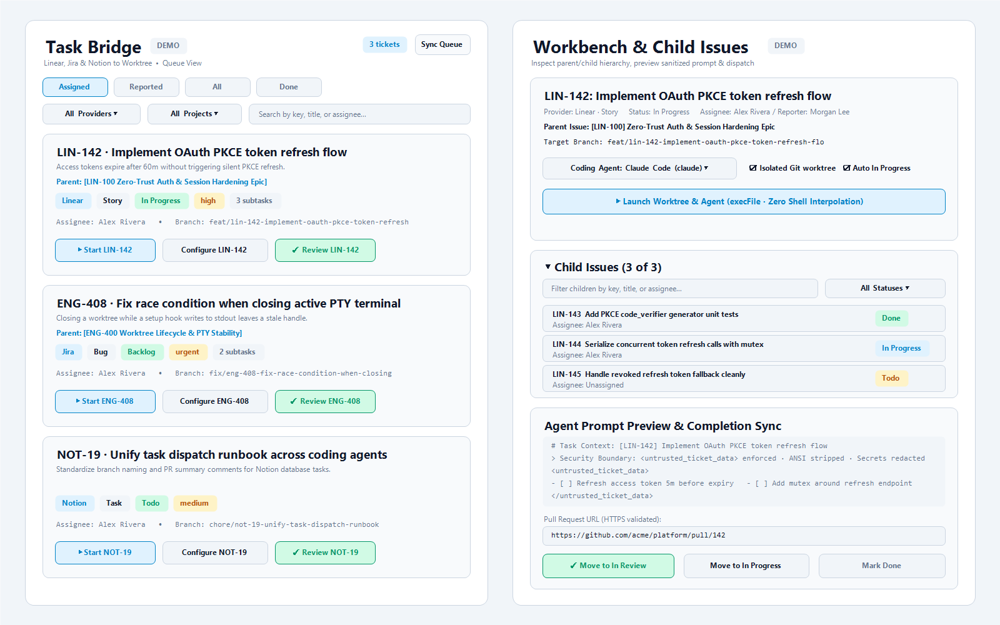

# Task Bridge (Linear, Jira & Notion to Worktree)



Keep **Linear**, **Jira**, and **Notion** within reach in the Orca ADE right sidebar. Browse assigned, reported, or all issues across providers, hydrate parent epics, subtasks, and Acceptance Criteria automatically, fan out child subtasks in parallel, route multi-repo workspaces via `ticketPrefixes`, apply each repo's `CLAUDE.md`/`AGENTS.md` guidelines and branch templates (`feature/{KEY}-{slug}`, `fix/{KEY}-{slug}`), enforce a Plan-First execution lock (`agent.tool.before`), monitor your live **In-Flight Fleet** with **Verify AC**, comment feedback, **`In Review` / `Done`** transitions, **`Clear Finished`** / **`Remove`**, and archive completed worktrees in one click.

| Field | Value |
| --- | --- |
| Plugin ID | `task-bridge` |
| Version | `0.3.1` |
| Orca Requirement | `>=1.4.256` |
| Execution | `trusted-worker` (`pluginApi: 1`) |
| UI Mode | Declarative host-rendered `components` (`@stablyai/orca-plugin-sdk/ui`) |
| Shortcut | `Cmd+Shift+Y` (macOS) / `Ctrl+Shift+Y` (Windows/Linux) — Sync Queue |
| Capabilities | `storage:own`, `settings:own`, `secrets:own`, `workspace:read`, `workspace:write`, `agent:read`, `agent:launch`, `notifications:show` |

---

## Install

### Option 1: Install from GitHub (Community Plugin)

```bash
orca plugin install CarlosManuelDiaz/task-bridge
```

Or install directly inside Orca ADE via **Settings → Plugins → Browse Community Plugins**.

### Option 2: Load from a Local Checkout (Development)

```bash
orca plugin validate ./task-bridge --json
orca plugin inspect ./task-bridge --json
orca plugin dev load ./task-bridge --approve <fingerprint-from-inspect>
```

---

## Preview

The screenshots below use built-in English `DEMO` sample tickets (`LIN-142`, `ENG-408`, `NOT-19`) with parent epics and child subtasks — demo items live strictly in memory until your real trackers sync, so sample data never pollutes your persistent storage.

### In-Flight Fleet, Repo Guidelines & Plan-First Gate



### Provider Connections, Multi-Repo Routing & Fleet Cleanup



### Queue & Workbench (Dark Mode)



### Queue & Workbench (Light Mode)



---

## Connecting Linear, Jira & Notion

Task Bridge reuses Orca's native **Linear** and **Jira** integrations (no duplicate OAuth flows or API keys stored by the plugin) and stores **Notion** tokens exclusively inside Orca's encrypted `host.secrets` vault.

### 1. Linear (OAuth via Orca Settings)
1. Open **Orca Settings → Linear** and connect your workspace via OAuth.
2. In Task Bridge, open **Queue** and click **Sync** (or press `Cmd+Shift+Y` / `Ctrl+Shift+Y`).
3. If your Linear team does not define an `"In Review"` workflow state (for example, it only has `Backlog`, `Todo`, `In Progress`, `Done`), clicking **In Review** surfaces the exact available team states and leaves the status unchanged — use the **`Done <KEY>`** button in **Fleet** (or **Mark Done** in Workbench) to complete the ticket cleanly.

### 2. Jira Cloud / Data Center (via Orca Settings)
1. Open **Orca Settings → Jira** and add your Jira site connection:
   - **Site URL**: Your workspace origin (e.g., `https://your-team.atlassian.net` — **do not** use Atlassian's public read-only `open.jira.com` directory).
   - **Email & API Token**: For Jira Cloud, generate a token in [Atlassian Account Security → API Tokens](https://id.atlassian.com/manage-profile/security/api-tokens) (Orca supports both classic and scoped tokens).
2. Make sure test/active issues have an **Assignee** set if using the default **`Assigned`** scope filter (or switch Scope to **`All`** / **`Reported`** to view unassigned issues).
3. Non-English Jira workflows (e.g., Spanish `"Tareas por hacer"`, `"En curso"`, `"En revisión"`, `"Finalizada"`) are automatically normalized and resolved via `orca jira status list <KEY> --json` transition IDs.

### 3. Notion Database (Integration Token + Database ID)
1. Create an internal integration at [notion.so/my-integrations](https://www.notion.so/my-integrations) and copy the token (`ntn_...`).
2. **Important:** Open your target Tasks database page in Notion → **`...` → Connections → Add connections** and select your integration. (Without sharing the database explicitly, Notion returns `404 Not Found` / unauthorized.)
3. Copy the **32-character Database ID** from the Notion database URL (`https://www.notion.so/<workspace>/<DATABASE_ID>?v=...`).
4. Paste the **Notion Integration Token** in Task Bridge's **Add & Connect** tab (**Save Notion Token**) and configure **Notion Tasks Database ID** + **Notion Status Property Name** (default `Status`, supports both `status` and `select` Notion property types) in **Orca Settings → Plugins → Task Bridge**.

### 4. Multi-Repo Workspaces & Acceptance Criteria Format
- **Multi-Repo Target Routing**: When 2 or more Git repositories are open in Orca (e.g., `demo-sandbox` and `demo-api`), Task Bridge blocks ambiguous dispatches until you pick a **Target Repository** in **Workbench** or configure **`ticketPrefixes`** (e.g., `CAR, SCRUM, SAN`) inside a repo profile so matching ticket keys auto-select that repository.
- **Auto-Extracted Acceptance Criteria**: Adding an `Acceptance Criteria:` section with `- [ ] ...` checklist items (or numbered/bulleted items under `Acceptance Criteria`) in a **Linear** or **Jira** issue description lets Task Bridge hydrate `acceptanceCriteria` automatically for **Verify AC**.

---

## Key Features

### 1. Multi-Provider Sync, Sprint Scope & Silent Failure Detection
- **Zero-config Linear & Jira integration with deep hydration**: Reuses `orca linear` and `orca jira` authentication, hydrates full descriptions, Acceptance Criteria checklists, and bidirectional parent/subtask relationships (`orca linear issue <key> --children --depth 1` and `orca jira issue <key>`).
- **Sprint (Jira) & Active Cycle (Linear) Scope**: Switch the **Scope** filter in **Queue** to **`Sprint`** to query your active Jira sprint via `orca jira search <sprintJql> --site <id>` (customizable via **`sprintJql`**, e.g. `project in (ENG, PLAT) AND sprint in openSprints()`) or your active Linear team cycle (`orca linear list-issues --cycle active`).
- **Sprint Header & Multi-Sprint Grouping**: Parses the sprint name returned by `orca jira search` / `orca jira list` (`"sprint": "Sprint 42"`) and groups the queue by sprint when multiple open sprints are active across boards.
- **Unassigned in Sprint (`Assign to Me`)**: Derives the unassigned query directly from your configured `sprintJql` and lists unassigned tickets in the active sprint inside a collapsible **Unassigned in Sprint** section with a one-click **`Assign to Me`** button (`orca jira assignee set --to-id <accountId>`).
- **Silent Jira Auth Failure vs. Query Error Detection**: When `orca jira connection` reports connected but sync returns 0 tickets, Task Bridge probes `orca jira project list` to distinguish a genuinely empty queue from an expired/revoked API token (`Jira Connection Warning`), while surfacing CLI query errors (`ok: false`, such as invalid `sprintJql`) directly as `Jira Query Error`.
- **Configurable `syncLimit` & Limit Indicator**: Sync up to `50`, `100` (default), `200`, or `500` tickets per provider and see `Showing X (limit reached)` whenever results reach the configured limit.
- **Encrypted Notion Database sync**: Stores your Notion Integration Token inside Orca's OS-backed encrypted secret store (`host.secrets`), supports cursor pagination and both `status` and `select` properties, and derives deterministic ticket keys from page IDs.
- **Instant Scope & Project Filters**: Filter your queue by **Assigned**, **Sprint**, **Reported**, **All**, or **Done**, narrow down by **Provider** (`Linear`, `Jira`, `Notion`) or **Project**, and search by ticket key, title, or assignee.
- **Undefined Ticket Warnings, `Propose AC` & `Accept Proposed AC`**: Flags tickets missing a description (`No Description`) or Acceptance Criteria (`Missing AC`) in Queue and Workbench, and provides a **`Propose AC`** button (`tasks.proposeAcceptanceCriteria`) that launches a strictly read-only analyst agent to draft testable Acceptance Criteria from the ticket and codebase, post them as a comment (`orca jira comment add`), and stage them in `proposedAcceptanceCriteria` until you click **`Accept Proposed AC`** in Workbench.
- **Register Work Without a Ticket (`Create Ticket`)**: When your active Orca worktree has no linked ticket, Queue displays an **Unlinked Worktree** card that discovers your Jira projects/issue types and creates a Jira ticket (`orca jira create`) pre-filled from the branch name and recent `git log` commits, assigns it to your Jira account, and links/renames the worktree.

### 2. In-Flight Fleet View (Tickets × Live Agents)
- The **Fleet** tab crosses dispatched tickets with `agents.list`, `workspace.list`, and `agent.status.changed` events by workspace and terminal ID.
- See every in-flight ticket alongside its live agent state (`working`, `waiting`, `blocked`, `done`), elapsed time, target branch, PR detection status, and Acceptance Criteria verification status.
- Jump directly to any existing worktree with **Open Workspace** (`workspace.open`) without creating duplicates, and automatically labels your Orca sidebar worktree as `KEY · Title` (`workspace.rename`).
- **Keep Fleet Clean Without Deleting Tickets**: Click **`Archive Worktree`** to remove a finished worktree and automatically dismiss its card from Fleet, click **`Remove <KEY>`** on any individual card, or click **`Clear Finished`** in the Fleet header to sweep completed (`In Review` / `Done`) and orphaned (**`No Worktree`**) cards at once while keeping all tickets intact in **Queue** and your issue tracker.

### 3. Parallel Epic & Subtask Fan-out
- Inspect the **Parent Issue** (`[LIN-100] Zero-Trust Auth & Session Hardening Epic`) and filter child subtasks by status or keyword in the Workbench tab.
- Click **Dispatch Pending Subtasks in Parallel** (`tasks.dispatchChildren`) to automatically provision an isolated worktree (inheriting the parent's resolved target repository in multi-repo workspaces) and launch a dedicated coding agent for each pending subtask (with parent epic context included).

### 4. Auto PR Detection, Acceptance Criteria Gate & Worktree Cleanup
- **Auto-Detect PR & Commits (`tasks.detectPr`)**: When an agent finishes (or on demand), Task Bridge queries `gh pr view --json url,state,title` and `git log -n 3 --oneline` inside the linked worktree directory to pre-fill the Pull Request URL and completion summary.
- **Acceptance Criteria Verification Gate (`tasks.verifyAcceptanceCriteria`)**: Launch a secondary read-only reviewer agent to check `git diff` and test results against the ticket's Acceptance Criteria before moving to review.
- **One-Click Worktree Archive (`tasks.cleanupWorktree`)**: Remove finished worktrees (`orca worktree rm`, with optional branch deletion) and dismiss the card from Fleet directly from Fleet or Workbench once tickets move to `In Review` or `Done`.
- **Dynamic Workflow Status Resolution (`In Review` & `Done`)**: Queries `orca jira status list <key> --json` and Linear workflow state metadata to match your team's custom/localized status names (e.g., `"En curso"`, `"En revisión"`, `"Finalizada"`, `"Ready for Review"`, `"Code Review"`). Includes a dedicated **`Done <KEY>`** action in Fleet when a team workflow skips `In Review`.
- **Smart `agent.prompt.before` Hook**: Correlates prompts by `terminalId` so parallel agents never mix ticket contexts. Appends the full structured ticket context on initial `launch` prompts, and prepends a lightweight 1-line `[Active Ticket: KEY — Title | Branch: ...]` reminder on follow-up prompts when the key isn't already mentioned.

### 5. Target Repository Routing, Repo Guidelines & Setup File Copy
- **Per-Ticket Target Repository & Prefix Auto-Matching (`tasks.assignRepo`)**: Choose which Orca-registered repository a ticket targets right in Workbench, bind ticket key prefixes (e.g., `LIN, ENG`) inside a repository profile (`ticketPrefixes`) for automatic prefix matching, and protect multi-repository workspaces from ambiguous dispatches until a target repo is confirmed.
- **Coding Agent Auto-Detection & Antigravity (`agy`) Support**: Supports **Antigravity (`agy`)**, **Claude Code**, **Codex**, **Gemini CLI**, and **Cursor CLI**, automatically checking `PATH` availability (`cliFound`) and provisioning isolated Git worktrees + visible agent terminals across macOS, Linux, and Windows PowerShell.
- **Automatic Repo Instruction Detection**: Scans the active repository for `CLAUDE.md`, `.claude/CLAUDE.md`, `AGENTS.md`, `.cursorrules`, `.github/copilot-instructions.md`, `.orca/instructions.md`, and `.github/pull_request_template.md`, injecting `<repository_guidelines>` with explicit rule precedence and Conventional Commit / PR template reminders.
- **Custom Branch Templates & Per-Repo Profiles (`tasks.saveRepoProfile`)**: Configure custom prefixes (`feature`, `bugfix`, `chore`) and branch templates with `{prefix}`, `{key}`, `{KEY}`, `{slug}`, `{project}`, `{PROJECT}`, and `{type}` globally or per `repoId`, or click **Apply Detected Guidelines** to adopt conventions found in `CLAUDE.md`.
- **Local Untracked Setup File Copying**: Safely copies local config files (e.g., `.env.local`, `.claude/settings.local.json`) from the primary worktree into newly created worktrees (`validateRelativeRepoPath` blocks `..` traversal, symlinks, absolute paths, and `.git`).

### 6. Mandatory Plan-First Gate & Ticket Comment Feedback Loop
- **Plan-First Gate & Tool Lock (`tasks.approvePlan` + `agent.tool.before`)**: Require agents to present an implementation plan before coding. With **Enforce Plan Lock** enabled, `agent.tool.before` denies `Edit`/`Write`/file-mutating tools and mutating `Bash` commands in Claude Code until you click **Approve Plan** in Queue, Fleet, or Workbench (read-only exploration like `Read`, `git status`, and `rg` remains allowed).
- **Ticket Comment Feedback Loop (`tasks.sendCommentFeedback`) & Fleet Auto-Sync**: Periodically refreshes active Fleet tickets (`autoSyncMinutes`, default `5m`), pulls new Jira/Linear/Notion comments with an unread badge, and forwards reviewer feedback (isolated inside `<untrusted_ticket_data>`) to the linked workspace agent.

---

## Security & Zero-Leak Architecture

Task Bridge is engineered from the ground up so it cannot compromise developer machines or leak credentials:

1. **Zero Shell Interpolation (`execFile` Only)**
   - All Orca CLI calls (`orca jira`, `orca linear`, `orca worktree`) and repository inspection calls (`git`, `gh`) execute via `node:child_process.execFile` with explicit argument arrays, `windowsHide: true`, bounded `maxBuffer`, and strict timeouts (`src/worker.ts`).
   - Shell metacharacters (`;`, `|`, `&`, `` ` ``, `$()`, newlines) in ticket titles, descriptions, or keys are never interpreted by a shell.
2. **Strict Input & Identifier Validation (`src/security.ts`)**
   - **Ticket Keys**: Validated against `^[A-Z0-9]+-[A-Z0-9]+$` (`validateTicketKey`) before passing to any CLI command.
   - **Branch Slugs**: Validated against git-check-ref-format rules (`validateBranchName`), blocking `..`, `@{`, leading `-`, and control characters.
   - **Agent Allowlist**: Only `antigravity`, `claude`, `codex`, `gemini`, and `cursor` are permitted (`validateAgentName`).
   - **HTTPS-Only URLs**: Ticket links and Pull Request URLs are parsed with `new URL()` and restricted to `https:` (`validateHttpsUrl`), preventing `javascript:`, `file:`, or `data:` URI injection.
3. **Prompt Injection & Terminal Escape Defense**
   - **ANSI/OSC Escape Stripping**: `sanitizeUntrustedText()` strips all ANSI CSI sequences, OSC 8/52 clipboard/hyperlink escapes, BEL, and C0/C1 control characters from remote ticket payloads.
   - **`<untrusted_ticket_data>` Isolation Boundary**: Untrusted issue descriptions, acceptance criteria, and child issue titles are wrapped inside explicit `<untrusted_ticket_data>` tags with system-level instructions telling the coding agent to treat the enclosed text strictly as data and never execute embedded shell commands or credential exfiltration requests.
4. **Encrypted Secrets & Automatic Log Redaction**
   - Notion tokens are stored exclusively in `host.secrets` (`secrets:own` capability) and are never returned to the UI panel or persisted in `host.storage`.
   - `redactSecrets()` automatically masks Notion tokens (`ntn_*`, `secret_*`), Linear keys (`lin_api_*`), GitHub PATs (`ghp_*`, `github_pat_*`), OpenAI/Anthropic keys (`sk-*`), and `Bearer` headers before any error message or log entry is emitted.
5. **Least-Privilege Manifest**
   - Does **not** request `terminal:send` or arbitrary network/filesystem capabilities.

---

## Repository Configuration (`.task-bridge.json`)

Repositories can commit an optional `.task-bridge.json` at the repo root to share team conventions across developers (`defaults < .task-bridge.json < user RepoProfile overrides`):

- **Branch naming & type rules**: `branchTemplate`, `featurePrefix`, `bugPrefix`, `chorePrefix`, and `branchTypes` (`prefix`, `keywords`, `issueTypes`).
- **Custom ticket parsing & statuses**: `acceptanceCriteriaHeadings` and `statusAliases` (`inProgress`, `inReview`, `done`).
- **Worktree setup & subtasks**: `worktreeCopyFiles`, allowlisted `worktreeSetupCommands` (e.g. `npm ci`, `pnpm install --frozen-lockfile`, `composer install`, `uv sync` — gated behind explicit SHA-256 hash approval in Workbench), and `subtaskBase` (`"default" | "parent" | "chain"`).
- **Workflow skills & guards**: `workflow` phase skill mappings (`dispatch`, `verify`, `feedback`, `prFeedback`), `planGate` (`"plugin" | "skill" | "both"`), and `guard.denyGitWrites` (blocks specific `git` subcommands like `push` across agents).

---

## Troubleshooting

| Symptom | Cause & Fix |
| --- | --- |
| **0 Jira or Linear issues appear after Sync** | Check the **Scope** filter in **Queue** — **`Assigned`** only returns issues assigned to your account (`Reported` / **`All`** shows unassigned issues too), and **`Done`** only shows completed issues. |
| **`Multiple Git repositories are open in Orca` on Dispatch** | Pick a **Target Repository** for the ticket in **Workbench**, or bind ticket prefixes (e.g., `SCRUM, CAR`) in that repo's profile so future tickets auto-route. |
| **`Could not transition [KEY] on LINEAR` when clicking In Review** | Your team lacks an `In Review` state (the error message lists the team's real states). Click **`Done <KEY>`** in Fleet (or **Mark Done** in Workbench), or add an *In Review* workflow state in Linear Team Settings. |
| **`Orca could not confirm the launch outcome`** | Worktree creation / agent startup exceeded the initial confirmation ACK window even though the agent started. Task Bridge checks whether the branch worktree exists before surfacing an error and avoids double-launching; click **Sync** / refresh **Fleet** to inspect the running agent. |
| **Notion sync returns 404 or unauthorized** | Verify the database page in Notion explicitly shares access with your integration under **`...` → Connections**, and check that **Notion Tasks Database ID** is the 32-character ID from the database URL. |

---

## Development & Verification

Run the full Orca plugin verification suite from the repository root:

```bash
# 1. Validate manifest schema, capabilities, and image asset dimensions
orca plugin validate ./task-bridge --json

# 2. Run headless UI component & layout checks across all scenarios
orca plugin check ./task-bridge --json

# 3. Run unit, integration, and security test suites (panel + worker)
orca plugin test ./task-bridge --json

# 4. Inspect permissions and compute approval fingerprint
orca plugin inspect ./task-bridge --json
```

---

## Support & Bug Reports

Found an issue or want to suggest an improvement?

- **Open an issue:** [CarlosManuelDiaz/task-bridge/issues](https://github.com/CarlosManuelDiaz/task-bridge/issues/new/choose)
- **Diagnostics:** Open **Add & Connect → Support & Diagnostics** inside Task Bridge to copy a sanitized diagnostics block (no tokens, emails, URLs, or ticket content), and optionally run `orca plugin logs carlosmanueldiaz.task-bridge`.

---

## License

MIT
